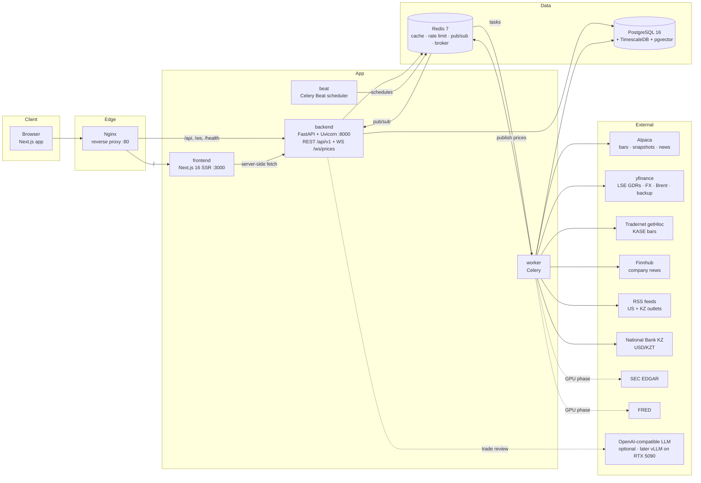
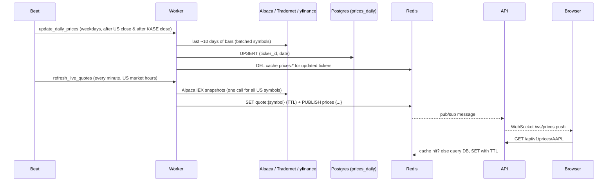
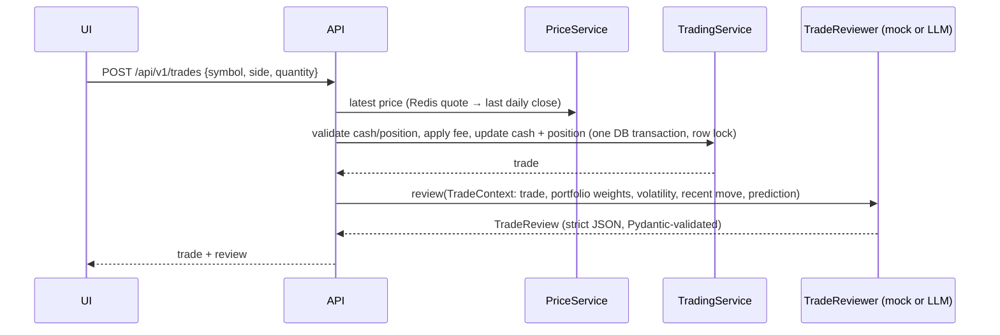
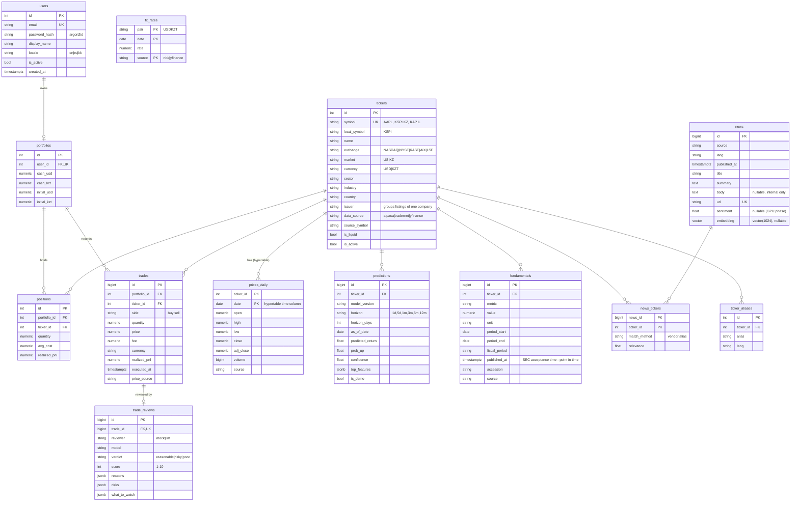

# Architecture

Educational project — **not investment advice**. This document describes the whole system; parts marked *(GPU phase)* are planned, not built yet.

## 1. Services



| Service | Image / runtime | Role |
|---|---|---|
| `db` | `timescale/timescaledb-ha:pg16` (TimescaleDB + pgvector) | relational data, price hypertable, news embeddings |
| `redis` | `redis:7-alpine` | cache (TTL), rate-limit counters, pub/sub for live prices, Celery broker/result backend |
| `backend` | Python 3.12, FastAPI, Uvicorn | REST API, WebSocket, auth, paper trading, ML interfaces |
| `worker` | same image, `celery worker` | data updates, trade reviews with slow LLMs, *(GPU phase)* nightly inference |
| `beat` | same image, `celery beat` | periodic schedule |
| `frontend` | Node 22, Next.js 16 (App Router), standalone output | UI |
| `nginx` | `nginx:alpine` | single origin: `/` → frontend, `/api` + `/ws` → backend |

## 2. Data flows

### 2.1 Prices

- Source routing per ticker is stored in `tickers.data_source` (`alpaca`, `tradernet`, `yfinance`) + `tickers.source_symbol`, so adding a listing needs no code change.
- KASE bars come from Tradernet in one batched request per run; LSE GDRs, FX (`KZT=X`) and Brent (`BZ=F`) from yfinance; the official USD/KZT rate from the National Bank RSS.

### 2.2 News
Beat → `update_news` (every 30 min): Alpaca news (tickers tagged by vendor) + Finnhub company news for the US seed list + RSS feeds (US and KZ). Each item is de-duplicated by URL, language detected from the feed (`en`/`ru`/`kk`), and linked to tickers by **(a)** vendor tags and **(b)** alias matching (`ticker_aliases`: "Kaspi", "Каспи", "Halyk", "Халык", "Народный банк", "Қазатомөнеркәсіп"...). `sentiment` and `embedding` stay `NULL` until the GPU phase fills them.

### 2.3 Paper trading and AI review

If the reviewer fails or times out, the trade is still stored and the review falls back to the rule-based mock (marked as such).

### 2.4 Predictions
`PredictionProvider.predict(ticker, as_of, horizons)` returns `PredictionResult`s. Today `MockPredictionProvider` produces deterministic demo values (hash of ticker + date + horizon, nudged by real recent momentum) and every prediction is stored with `is_demo = true` → the UI shows a **"Demo predictions"** badge. In the GPU phase a nightly Celery task runs the real provider for the whole universe and writes to `predictions`; the API serves the latest row per (ticker, horizon).

## 3. Database schema



Notes:
- `prices_daily` is a TimescaleDB hypertable partitioned on `date` (1-year chunks; ~10 k rows/ticker for 40 years is tiny). Primary key `(ticker_id, date)` makes daily upserts idempotent.
- `fundamentals.published_at` is the SEC `acceptanceDateTime` (or `filed` date) — features may only use rows with `published_at` < prediction time (look-ahead rule).
- `news.embedding` is `vector(1024)` to match multilingual embedding models with 1024 dimensions (bge-m3, multilingual-e5-large), see D-016.
- Money columns are `NUMERIC(20, 6)`; prices `NUMERIC(20, 6)`; no floats for cash.

## 4. API contract (`/api/v1`)

All responses are JSON. Errors: `{"detail": "..."}` with proper HTTP status. Auth = `Authorization: Bearer <access JWT>`.

| Method | Path | Auth | Description |
|---|---|---|---|
| GET | `/health` | – | liveness + DB/Redis checks |
| POST | `/auth/register` | – | `{email, password, display_name?}` → user + tokens; creates portfolio with starting balance |
| POST | `/auth/login` | – | `{email, password}` → `{access_token, refresh_token, token_type}` |
| POST | `/auth/refresh` | – | `{refresh_token}` → new token pair |
| GET | `/auth/me` | ✔ | current user |
| GET | `/tickers` | – | list; filters `market=US\|KZ`, `exchange`, `q`, `limit`, `offset` |
| GET | `/tickers/search?q=` | – | fast search by symbol / name / alias (top 10) |
| GET | `/tickers/{symbol}` | – | ticker details + latest quote |
| GET | `/market/overview?market=US\|KZ` | – | tickers with last price/change, top gainers/losers, USD/KZT, Brent |
| GET | `/prices/{symbol}?start=&end=` | – | daily OHLCV bars (cached) |
| GET | `/prices/{symbol}/latest` | – | latest quote (live quote if fresh, else last close) |
| GET | `/news?symbol=&lang=&limit=&offset=` | – | news list, newest first |
| GET | `/predictions/{symbol}` | – | latest prediction per horizon + `is_demo`, `model_version`, disclaimer |
| GET | `/fx/latest` | – | USD/KZT (official + market) |
| GET | `/portfolio` | ✔ | cash (USD, KZT), positions with market value and P&L, totals in USD and KZT |
| POST | `/portfolio/reset` | ✔ | reset to starting balance |
| POST | `/trades` | ✔ | `{symbol, side, quantity}` → executed trade + review |
| GET | `/trades` | ✔ | trade history with reviews |
| GET | `/trades/{id}` | ✔ | one trade + review |
| POST | `/trades/{id}/review` | ✔ | re-run the review (e.g. after switching to the LLM reviewer) |
| GET | `/meta` | – | active prediction provider / reviewer (mock or real), disclaimer text, supported currencies |
| WS | `/ws/prices?symbols=AAPL,MSFT` | – | pushes `{"type":"quote","symbol","price","change_pct","ts"}` |

Rate limits (Redis, fixed window per client IP; per user when authenticated): general 120 req/min, `/auth/*` 10 req/min, `POST /trades` 30 req/min → `429` with `Retry-After`.

Caching (Redis): price history 10 min, latest quote 60 s, market overview 60 s, predictions 1 h, news 5 min. Data-update tasks invalidate the affected keys.

## 5. How the ML part plugs in

```
backend/app/ml_interface/
├── base.py          # PredictionProvider, TradeReviewer (ABCs) + Pydantic I/O schemas
├── mock.py          # MockPredictionProvider, MockTradeReviewer (rule-based)
├── openai_compat.py # OpenAICompatibleTradeReviewer (any OpenAI-compatible /chat/completions, incl. vLLM)
└── factory.py       # builds providers from settings
```

- `PREDICTION_PROVIDER=mock|mlflow` and `TRADE_REVIEWER=mock|llm|auto` in `.env` choose the implementation; `auto` uses the LLM reviewer only when `LLM_BASE_URL`, `LLM_API_KEY` and `LLM_MODEL` are set. **Switching to real models = changing these variables** (and starting vLLM / having MLflow reachable); no code in the API layer changes.
- *(GPU phase)* `MLflowPredictionProvider` loads the model registered as `production` (`models:/short_term_gbm@production`, `models:/long_term_rank@production`) and uses the shared feature module `ml/features/` — the same code that built the training set — to compute features as of the prediction date.
- *(GPU phase)* the trade reviewer is served by **vLLM** with an OpenAI-compatible endpoint on the RTX 5090 machine, so `OpenAICompatibleTradeReviewer` is reused as-is (`LLM_BASE_URL=http://gpu-box:8001/v1`). Its output is forced to strict JSON (`response_format={"type":"json_object"}` + Pydantic validation + one retry, then fallback to the mock).
- *(GPU phase)* nightly Celery task `run_nightly_inference` writes predictions for all tickers with `is_demo=false`; the "Demo" badge disappears automatically because the API reports `is_demo` per prediction.

## 6. Security and compliance
- Secrets only in `.env` (git-ignored); `.env.example` documents every variable. Settings objects never log secret values (`SecretStr`).
- Passwords: argon2id (`argon2-cffi`). JWT HS256: access 15 min, refresh 7 days, `type` claim checked; refresh tokens carry a `jti`.
- CORS restricted to the frontend origin; behind Nginx the app is same-origin.
- Disclaimer component on every page that shows predictions or reviews; API responses for predictions/reviews carry a `disclaimer` field.
- Data use: headlines + links only on the site; respect robots.txt and rate limits (SEC ≤ 10 req/s, Tradernet ≥ 5 s between calls, GDELT ≤ 1 req/5 s).
